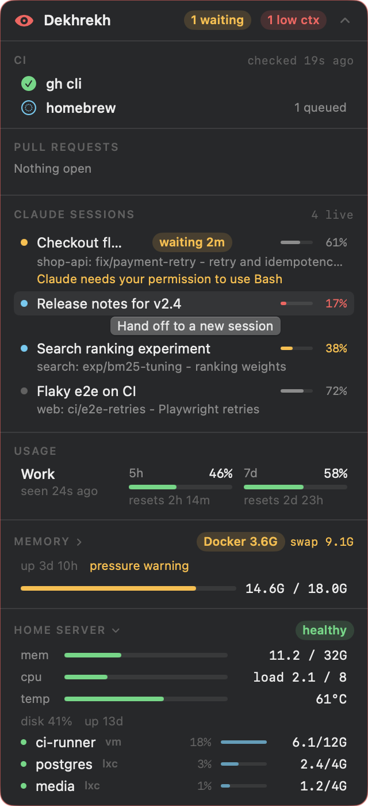
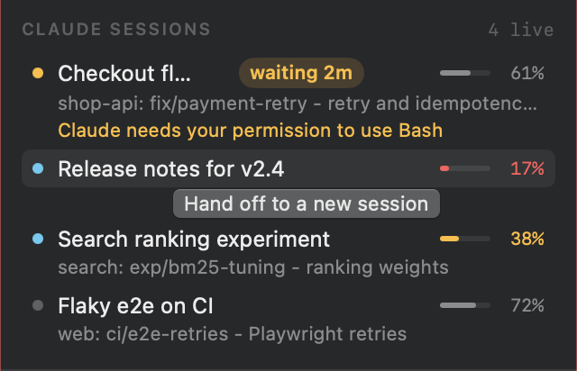

# Dekhrekh

An always-on-top macOS panel for people who run several Claude Code sessions at once. It shows which
session is waiting on you, which is running out of context, your usage limits, and whether CI went red.
Your agents get the same view from the terminal, so they can coordinate without you.

*Dekhrekh* (देखरेख) is Hindi for looking after something.

<p align="center">
  
</p>

## Why

- **Claims.** Before touching a repo, a session runs `dekhrekh claims` and records which branch and
  files it is changing, so two agents don't edit the same checkout.
- **CI gates.** After a push, a session runs `dekhrekh ci --wait` and gets the failing step's log
  instead of asking you whether CI passed.
- **Context handoffs.** When a session drops below 30% context, one click has it write a handoff and
  opens a fresh session that continues from it. Results from subagents it still has running are passed on.

It watches the sessions you start in your own terminal. There is no wrapper to adopt.

## What it shows



- **Sessions.** Status, context left and what each session is working on. A session blocked on a
  permission prompt shows what it is asking for; one that ended its turn with a question shows
  "your turn". Click a session to jump to its tab in Ghostty, iTerm2 or Terminal.app (and its tmux
  pane), or to its project window in VS Code, Cursor, Windsurf, Zed or a JetBrains IDE.
- **Usage.** 5-hour and 7-day limits, when you will hit them at the current rate, a chime at 75% and
  90%, and the running cost of today's sessions at API prices.
- **CI and pull requests** for the repos you list: failing runs, PRs waiting on your review, and your
  own PRs that are failing or ready to merge.
- **Memory**, with the apps using the most and a hint when a restart would help.
- **Server card** (optional): memory, load and temperature of a machine you run.

It chimes when a session starts waiting or CI fails, and after a reboot offers to reopen the sessions
you had open. Collapsed, it is a single bar:


<br clear="right">

## Install

Requires macOS 14+, Xcode Command Line Tools (`xcode-select --install`) and
[Claude Code](https://docs.claude.com/en/docs/claude-code). The CI and PR sections also need the
[GitHub CLI](https://cli.github.com), signed in.

```sh
git clone https://github.com/Ditou007/dekhrekh.git
cd dekhrekh
./build.sh --install   # app to ~/Applications, CLI to ~/.local/bin, starts at login
dekhrekh setup         # connects Claude Code to Dekhrekh
```

Or build it with Homebrew: `brew install --HEAD ditou007/tap/dekhrekh`.

`dekhrekh setup` adds two things to each Claude Code `settings.json`, after writing a backup:

- a status line feed. If you already have a status line, yours keeps working and prints the same
  thing; Dekhrekh records a copy of its input first. It also refreshes every 30 seconds so idle
  sessions keep reporting usage.
- a Notification hook, which records what a session is waiting on.

Run `dekhrekh setup --dry-run` to see the changes first. The first time you click a session, macOS
asks whether Dekhrekh may control your terminal; allow it.

Handoff, `tell` and restore type into a terminal tab, so they need [Ghostty](https://ghostty.org).
Built and used on Apple Silicon; Intel should build but is untested.

## Configuration

Without a config file, Dekhrekh watches one Claude profile in `~/.claude` and hides the CI, PR and
server sections. To change that, create `~/.config/dekhrekh/config.json`. Every key is optional:

```json
{
  "profiles": [
    { "name": "work", "title": "Work", "claudeDir": "~/.claude" },
    { "name": "personal", "title": "Personal", "tag": "ME", "claudeDir": "~/.claude-personal",
      "launch": "CLAUDE_CONFIG_DIR=~/.claude-personal claude" }
  ],
  "repos": [
    { "repo": "your-org/api" },
    { "label": "web", "repo": "your-org/web", "branches": ["main"] }
  ],
  "server": { "title": "Home server", "url": "http://homeserver.local:8080/status" }
}
```

| Key | Meaning |
|-----|---------|
| `profiles` | One per Claude Code config folder. `launch` starts Claude Code with that profile (used by handoff and restore); `tag` labels its sessions. |
| `repos` | GitHub repos to watch. `ghUser` picks a `gh` account if you have several. With `actors` or `branches`, only those runs count. |
| `server` | Turns on the server card. `parked` lists machines stopped on purpose. |
| `stateDir` | Where Dekhrekh keeps its files (default `~/.claude/state/dekhrekh`). |

`dekhrekh config` shows what was loaded. Restart the app after editing.

<details>
<summary>Server card JSON</summary>

The card polls `url` every 30 seconds. Only `node` is required.

```json
{
  "node": { "mem_used_gb": 11.2, "mem_total_gb": 32, "load1": 2.1, "disk_pct": 41, "uptime_h": 312 },
  "cores": 8,
  "temp_c": 61,
  "containers": { "down": [] },
  "guests": [
    { "id": 101, "name": "ci-runner", "type": "qemu", "status": "running", "mem_gb": 6.1, "maxmem_gb": 12, "host_cpu_pct": 18 }
  ]
}
```
</details>

## Command line

Everything in the panel is available from the terminal, in a form other Claude sessions can read:

```text
$ dekhrekh sessions usage
CLAUDE SESSIONS (4 LIVE)
  Checkout flow: payment retries       WAITING 2m   ctx 61%
    waiting on: Claude needs your permission to use Bash
    working on: shop-api: fix/payment-retry - retry and idempotency keys
  Release notes for v2.4               busy         ctx 17%
  Search ranking experiment            busy         ctx 38%
    working on: search: exp/bm25-tuning - ranking weights
  Flaky e2e on CI                      idle         ctx 72%
    working on: web: ci/e2e-retries - Playwright retries
USAGE
  Work          5h 46% (resets 2h 14m)   7d 58% (resets 2d 23h)
```

| Command | What it does |
|---------|--------------|
| `dekhrekh show <session>` | One session's folder, branch, recent prompts, replies and tool calls |
| `dekhrekh claim "<repo>: <branch> - <what>"` / `claims` | Record what this session is changing / list every session's claim |
| `dekhrekh ci --wait` / `ci --stats` | Wait for CI on this branch and print the failing step / queue and run times per job |
| `dekhrekh handoff <session>` | The panel's handoff button |
| `dekhrekh tell <session> "…"` | Type a message into another session's tab (from your own terminal) |
| `dekhrekh restore` | Reopen the sessions that were open before a restart |

Add `--json` for scripts. To let your agents use it, add a few lines to `CLAUDE.md`:

```md
- Before starting work in a repo, run `dekhrekh claims`; record yours with `dekhrekh claim "<repo>: <branch> - <what>"`.
- After pushing, run `dekhrekh ci --wait` and report the result.
- To see what another session is doing, run `dekhrekh show <name>`.
```

## Privacy

- Everything stays on your Mac. Dekhrekh reads what Claude Code already records (`claude agents`,
  session files, transcripts), talks to GitHub through your `gh` login for the repos you list, and
  polls your server card URL. Nothing else: no analytics, no account.
- The panel is hidden from screenshots and screen sharing by default, since it shows prompts and repo
  names. Turn that off from its menu bar item.
- `tools/demo.sh` runs the panel on made-up sessions, which is how the screenshots above were taken.

## Building

`./build.sh` builds into `build/` without installing. Set `DEKHREKH_SIGN_ID` to a code-signing identity
to keep macOS permissions across rebuilds; otherwise it uses an Apple Development certificate if you
have one, else ad-hoc signing.

## License

MIT
